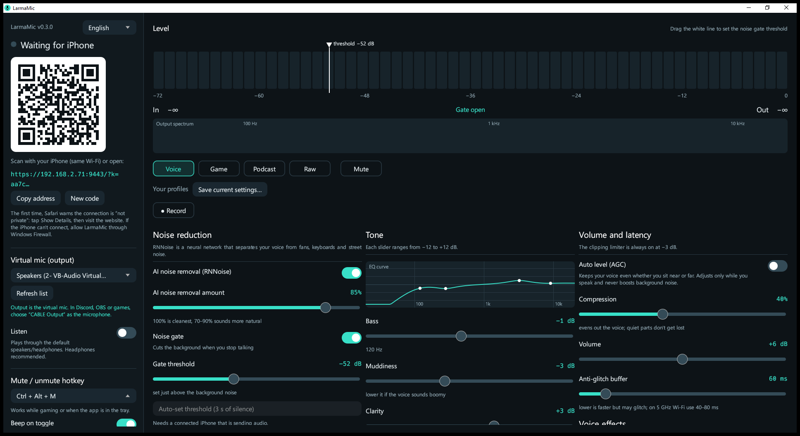

<div align="center">

  <h1>LarmaMic</h1>

  

  <br>

  <b>English</b> | <a href="./README_vi.md">Tiếng Việt</a>

  <br>

  
  
  
  
  

  <br><br>

  LarmaMic turns your iPhone into a PC microphone, with all the tuning done on the PC.

  One small Windows app · iPhone only needs Safari · no app to install on the phone

</div>

## Features

- Stream from an iPhone over Wi-Fi: scan the QR code in the desktop app and open the page in Safari. Nothing to install on the phone.
- Run a single portable `larma-mic.exe` (about 9 MB, no installer, no runtime). It sits in the system tray with ≈ 0% CPU and about 4 MB of RAM while hidden.
- Clean the voice with a processing chain at 48 kHz: AI noise removal ([RNNoise](https://jmvalin.ca/demo/rnnoise/)), rumble filter, noise gate with 5 ms lookahead, 4-band equalizer, auto level (AGC), compressor, volume and a −3 dB limiter.
- Add voice effects: pitch shift, reverb and robot voice.
- Watch the result live: level meter, output spectrum, EQ curve, estimated latency, buffer, glitch and drop counters.
- Auto-set the noise gate threshold: stay silent for 3 seconds and the app measures the background and sets it for you.
- Two-way sync: every control exists on the PC **and** on the phone page, and both always stay identical. Quick presets (Voice, Game, Podcast, Raw) and your own saved profiles are available on both.
- Mute with a global hotkey (default `Ctrl + Alt + M`, works in games) or a push-to-talk button on the phone, with a beep to confirm.
- Route audio through VB-Cable or Steam Streaming Microphone on Windows to use it in Discord, OBS, games, calls and recording apps.
- Record the filtered voice to a WAV file in one click.
- Keep working with the screen off: when iOS pauses the page, the mic and connection resume as soon as you return.
- Use 10 interface languages on both the PC app and the phone page, with automatic detection.
- Stay safe: HTTPS with a self-signed certificate, a random pairing code in the QR address, one phone at a time, and settings written through a temporary file with a `.bak` backup.

## Screenshots

### Desktop App



### iPhone Page


## Getting Started

1. Download `larma-mic.exe` from [GitHub Releases](https://github.com/mukii936/LarmaMic/releases), or [build it yourself](#build-from-source).
2. Set up a virtual microphone (once):

   | Option | How |
   |:---|:---|
   | **VB-Cable** | Install the free [VB-Cable](https://vb-audio.com/Cable/). In your call, game or streaming app, choose **CABLE Output** as the microphone. |
   | **Steam Streaming Microphone** | If Steam is installed, nothing else is needed. Choose **Steam Streaming Microphone** as the microphone. |

   LarmaMic picks one automatically (VB-Cable first) and warns you if the output points to your normal speakers.
3. Open LarmaMic, keep the iPhone and PC on the same Wi-Fi, and scan the QR code with the iPhone camera.
4. The first time, Safari says the connection is not private because of the self-signed certificate: tap **Show Details**, then visit the website. If the phone cannot connect, allow LarmaMic through Windows Firewall.
5. Tap **Start mic** on the phone and allow microphone access. The controls appear when the PC is connected.

You can also install it with the **Install…** button (Start Menu shortcut and an entry in Settings > Apps, no administrator rights), or from a terminal:

```powershell
larma-mic.exe --install      # or --uninstall; add --quiet to skip dialogs
```

## Languages

Tiếng Việt, English, 中文 (简体), 日本語, 한국어, Bahasa Indonesia, Español, Français, Deutsch, Русский.

The PC app follows the Windows language by default and can be changed from the picker at the top left; the tray menu changes with it. The phone page follows the PC language or your own choice. CJK fonts are loaded from Windows only when one of those languages is selected, to keep memory low.

> The translations were written with AI and have not been reviewed by native speakers. Corrections are very welcome.

To add a language, add `src/lang/xx.rs` (every key of the Vietnamese table in `src/i18n.rs`) and `web/src/i18n/xx.ts`, then register them. `cargo test` reports missing or extra keys, mismatched `{0}` placeholders and hardcoded Vietnamese strings; `npm run build` reports missing keys on the phone side.

## Build from Source

Requires Rust (MSVC toolchain) and Node.js.

```powershell
.\build.ps1                 # builds the React page, then the exe: target\release\larma-mic.exe
cargo test --release        # DSP, effects, spectrum, WAV, settings, run-at-login, i18n checks
```

To run a test copy next to your real one without touching its settings:

```powershell
$env:APPDATA = "$env:TEMP\larma-test"; $env:LARMA_LOCK_PORT = "47999"; $env:LARMA_PORT = "9443"
.\target\release\larma-mic.exe
```

For the phone page alone, run `npm run dev` inside `web/` to preview the UI without a PC connection.

## Technology

- Desktop: Rust, eframe/egui, cpal (WASAPI), axum with rustls, tray-icon, global-hotkey
- Audio: nnnoiseless (RNNoise), custom DSP chain, FFT spectrum, jitter buffer
- Phone page: React, TypeScript, Vite, Web Audio (AudioWorklet), WebSocket
- Protocol: raw 16-bit PCM over a WebSocket plus small JSON messages for parameters and meters

## Roadmap

- Code signing for the exe
- Android and other platforms are not supported yet; the phone page may already work in other mobile browsers, but only iPhone Safari has been tested

## Contributing

Bug reports, translation fixes and pull requests are welcome. Please open an issue first for larger changes.

## Acknowledgments

Special thanks to [MicYou](https://github.com/MicYou-Dev/MicYou) for the inspiration, including the idea of using Steam Streaming Microphone as a ready-made virtual microphone on Windows.

Special thanks to [Jean-Marc Valin](https://github.com/xiph/rnnoise) for RNNoise, [nnnoiseless](https://github.com/jneem/nnnoiseless) for its Rust port, and [VB-Audio](https://vb-audio.com/Cable/) for VB-Cable.
