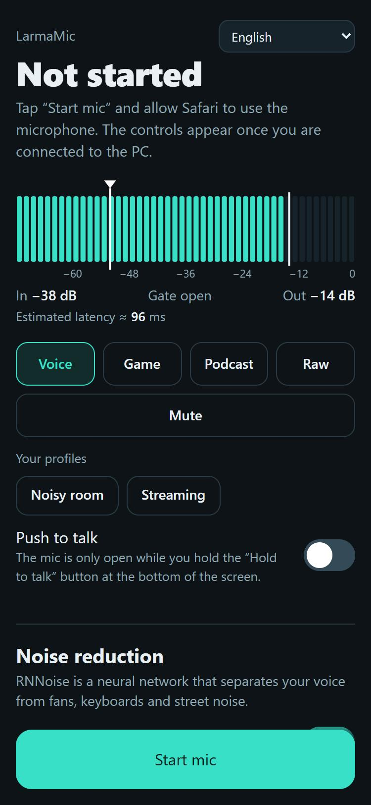

<div align="center">

  <h1>LarmaMic</h1>

  

  <br>

  <b>English</b> | <a href="./README_vi.md">Tiếng Việt</a>

  <br>

  
  
  
  
  <a href="https://github.com/mukii936/LarmaMic/actions/workflows/build.yml"></a>
  

  <br><br>

  LarmaMic turns your phone into a PC microphone, with all the tuning done on the PC.

  One small Windows app · iPhone (Safari) or Android (app) · Wi-Fi / USB cable / Bluetooth

</div>

## Features

- Use an **iPhone** with nothing to install (scan the QR code and open the page in Safari), or the native **Android app** that keeps streaming with the screen off.
- **Several phones at once** (up to 4, any mix of iPhone and Android): their voices are mixed into the one virtual microphone. The PC app lists each phone with its level and lets you mute or disconnect it. The mute switch and push-to-talk affect the whole mix.
- **No QR code needed on Android:** the app finds the PC on the network and asks to pair; you tap **Allow** on the PC (can be turned off). Over a USB cable with USB debugging, plugging in is enough.
- **More mixing control:** a gain slider per phone, and a **Loudest only** mode that follows whoever talks (instead of mixing everyone). Recording also saves each phone as its own track when two or more are connected.
- **Android extras:** volume buttons mute/unmute the mic even with the screen off, a Mute button in the notification and a Quick Settings tile, and **Hear myself** (the processed voice played back on the phone, use headphones).
- **Bluetooth uses compression** (IMA ADPCM, 4:1) so it sounds better than plain 24 kHz audio on a slow link.
- **Echo cancellation:** removes what the PC plays (the other side of a call) from the microphone so they do not hear themselves. It listens to the PC's output (WASAPI loopback), finds the echo delay by itself and subtracts it with an adaptive filter. Tested with simulated echo paths, not yet with a variety of real rooms: use headphones or turn it off if it sounds odd.
- Three ways to connect: **Wi-Fi**, **USB cable** (USB tethering) and **Bluetooth** (Bluetooth tethering). The QR code carries every address of the PC, and the phone tries them in turn.
- Run a single portable `larma-mic.exe` (about 9 MB, no installer, no runtime). It sits in the system tray with ≈ 0% CPU and about 4 MB of RAM while hidden.
- Clean the voice with a processing chain at 48 kHz: AI noise removal ([RNNoise](https://jmvalin.ca/demo/rnnoise/)), rumble filter, noise gate with 5 ms lookahead, 4-band equalizer, auto level (AGC), compressor, volume and a −3 dB limiter.
- Add voice effects: pitch shift, reverb and robot voice.
- Watch the result live: level meter, output spectrum, EQ curve, estimated latency, buffer, glitch and drop counters.
- Auto-set the noise gate threshold: stay silent for 3 seconds and the app measures the background and sets it for you.
- Two-way sync: every control exists on the PC **and** on the phone, and both always stay identical. Quick presets (Voice, Game, Podcast, Raw) and your own saved profiles are available on both.
- Mute with a global hotkey (default `Ctrl + Alt + M`, works in games) or a push-to-talk button on the phone, with a beep to confirm.
- Route audio through VB-Cable or Steam Streaming Microphone on Windows to use it in Discord, OBS, games, calls and recording apps.
- Record the filtered voice to a WAV file in one click.
- Save battery: a Battery saver button turns the phone screen black (and dims it) while the mic keeps streaming; double-tap to bring the controls back.
- Add the web page to the Home Screen (iPhone: Share > Add to Home Screen; Android: browser menu > Install app). It opens full screen and already paired.
- Keep working with the screen off: the Android app runs as a foreground service; on iPhone the page resumes as soon as you return to it.
- Use 10 interface languages on the PC app, the web page and the Android app, with automatic detection.
- Stay safe: HTTPS with a self-signed certificate (the Android app pins it on first use), a random pairing code in the QR address, one phone at a time, and settings written through a temporary file with a `.bak` backup.

## Screenshots

### Desktop App


### Phone Page (web)



## Getting Started

1. Download `larma-mic.exe` (and `larma-mic-android.apk` for Android) from [GitHub Releases](https://github.com/mukii936/LarmaMic/releases), or [build it yourself](#build-from-source).
2. Set up a virtual microphone (once):

   | Option | How |
   |:---|:---|
   | **VB-Cable** | Install the free [VB-Cable](https://vb-audio.com/Cable/). In your call, game or streaming app, choose **CABLE Output** as the microphone. |
   | **Steam Streaming Microphone** | If Steam is installed, nothing else is needed. Choose **Steam Streaming Microphone** as the microphone. |

   LarmaMic picks one automatically (VB-Cable first) and warns you if the output points to your normal speakers.
3. Open LarmaMic on the PC. Then choose how to connect:

   | Mode | What to do |
   |:---|:---|
   | **Wi-Fi** | Put the phone and the PC on the same Wi-Fi. |
   | **USB cable** | Android with **USB debugging** (turned on once): plug the cable in and LarmaMic opens on the phone and connects by itself, no QR code and no Wi-Fi. It needs Android's `adb` tool (found automatically, or one click in the app downloads it from Google). Otherwise turn on **USB tethering** on the phone. |
   | **Bluetooth** | Pair the phone with the PC, turn on **Bluetooth tethering** on the phone and join its network on the PC. Slower, so the Android app sends 24 kHz audio. |

4. Scan the QR code from LarmaMic:
   - **iPhone:** use the camera and open the page in Safari. The first time, the browser warns the connection is not private because of the self-signed certificate: tap **Show Details**, then visit the website. If the phone cannot connect, allow LarmaMic through Windows Firewall. Tap **Start mic** and allow microphone access.
   - **Android app:** open the app, choose the connection mode, tap **Scan QR code**, and allow the microphone and notifications. The app keeps the mic running with the screen off.
   - **Android without the app:** open the QR code address in Chrome (it works as a web page too, but the browser may pause the mic when the screen turns off).

Windows Firewall may treat the USB or Bluetooth network as public. If the phone cannot connect over it, allow LarmaMic for that network type in the firewall prompt.

You can also install LarmaMic with the **Install…** button (Start Menu shortcut and an entry in Settings > Apps, no administrator rights), or from a terminal:

```powershell
larma-mic.exe --install      # or --uninstall; add --quiet to skip dialogs
```

## Languages

Tiếng Việt, English, 中文 (简体), 日本語, 한국어, Bahasa Indonesia, Español, Français, Deutsch, Русский.

The PC app follows the Windows language by default and can be changed from the picker at the top left; the tray menu changes with it. The phone page and the Android app follow the PC language or your own choice. CJK fonts are loaded from Windows only when one of those languages is selected, to keep memory low.

> The translations were written with AI and have not been reviewed by native speakers. Corrections are very welcome.

To add a language, add `src/lang/xx.rs` (every key of the Vietnamese table in `src/i18n.rs`) and `web/src/i18n/xx.ts`, register them, then run `python android/tools/gen_strings.py` for the Android strings. `cargo test` reports missing or extra keys, mismatched `{0}` placeholders and hardcoded Vietnamese strings; `npm run build` reports missing keys on the phone side.

## Build from Source

Requires Rust (MSVC toolchain) and Node.js.

```powershell
.\build.ps1                 # builds the React page, then the exe: target\release\larma-mic.exe
cargo test --release        # DSP, effects, spectrum, WAV, settings, run-at-login, i18n checks
```

To run a test copy next to your real one without touching its settings:

```powershell
$env:APPDATA = "$env:TEMP\larma-test"; $env:LARMA_LOCK_PORT = "47999"; $env:LARMA_PORT = "9443"
.\target\release\larma-mic.exe
```

For the phone page alone, run `npm run dev` inside `web/` to preview the UI without a PC connection.

The Android app (`android/`) needs JDK 17 and the Android SDK (platform 35):

```powershell
cd android
.\gradlew.bat testDebugUnitTest assembleRelease   # appuild\outputspk
eleasepp-release.apk
```

The APK is signed with the debug key so it can be installed directly; it is not meant for the Play Store.

## Technology

- Desktop: Rust, eframe/egui, cpal (WASAPI), axum with rustls, tray-icon, global-hotkey
- Audio: nnnoiseless (RNNoise), custom DSP chain, FFT spectrum, jitter buffer
- Phone web page: React, TypeScript, Vite, Web Audio (AudioWorklet), WebSocket
- Android app: Kotlin, Jetpack Compose, OkHttp, AudioRecord in a foreground service
- Protocol: raw 16-bit PCM over a WebSocket plus small JSON messages for parameters and meters

## Packaging

- Publishing to winget: see [docs/WINGET.md](docs/WINGET.md) (manifests are ready in `packaging/winget`).
- Removing the SmartScreen warning with code signing: see [docs/SIGNING.md](docs/SIGNING.md).

## Roadmap

- Code signing for the exe (needs your certificate or a SignPath application)
- Opus instead of ADPCM for Bluetooth
- The Android app has not been tested on a real device yet; please report problems with audio, connection or the foreground service
- A native Bluetooth (RFCOMM) link without tethering
- macOS and Linux desktop apps

## Contributing

Bug reports, translation fixes and pull requests are welcome. Please open an issue first for larger changes.

## Star History

<a href="https://www.star-history.com/?repos=mukii936%2Flarmamic&type=date&legend=top-left">
 <picture>
   <source media="(prefers-color-scheme: dark)" srcset="https://api.star-history.com/chart?repos=mukii936/larmamic&type=date&theme=dark&legend=top-left" />
   <source media="(prefers-color-scheme: light)" srcset="https://api.star-history.com/chart?repos=mukii936/larmamic&type=date&legend=top-left" />
   
 </picture>
</a>

## Acknowledgments

Special thanks to [MicYou](https://github.com/MicYou-Dev/MicYou) for the inspiration, including the idea of using Steam Streaming Microphone as a ready-made virtual microphone on Windows.

Special thanks to [Jean-Marc Valin](https://github.com/xiph/rnnoise) for RNNoise, [nnnoiseless](https://github.com/jneem/nnnoiseless) for its Rust port, and [VB-Audio](https://vb-audio.com/Cable/) for VB-Cable.

## License

This project is licensed under the [MIT License](./LICENSE).
