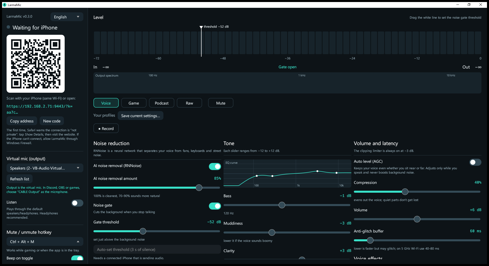
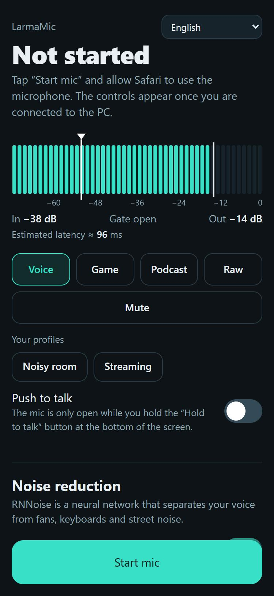

<div align="center">

  <h1>LarmaMic</h1>

  

  <br>

  <a href="./README.md">English</a> | <b>Tiếng Việt</b>

  <br>

  
  
  
  
  <a href="https://github.com/mukii936/LarmaMic/actions/workflows/build.yml"></a>
  

  <br><br>

  LarmaMic biến điện thoại thành micro cho máy tính, mọi việc chỉnh âm đều làm trên PC.

  Một app Windows nhỏ · iPhone (Safari) hoặc Android (app) · Wi-Fi / cáp USB / Bluetooth

</div>

## Tính năng

- Dùng **iPhone** mà không cài gì (quét mã QR rồi mở trang bằng Safari), hoặc **app Android** riêng, vẫn truyền tiếp khi tắt màn hình.
- **Nhiều điện thoại cùng lúc** (tối đa 4, iPhone hay Android đều được): tiếng của các máy được trộn vào một mic ảo duy nhất. App PC liệt kê từng máy với mức tiếng và cho tắt tiếng hoặc ngắt riêng từng máy. Nút tắt tiếng và giữ-để-nói tác động lên cả hỗn hợp.
- **Android không cần quét QR:** app tự tìm PC trong mạng và xin ghép nối; bạn bấm **Cho phép** trên PC (tắt được). Qua cáp USB có bật gỡ lỗi USB thì chỉ cần cắm cáp.
- **Trộn linh hoạt hơn:** thanh độ lợi riêng cho từng điện thoại, và chế độ **Chỉ người nói to nhất** (thay vì trộn tất cả). Khi ghi âm với từ 2 máy trở lên, mỗi máy còn được lưu thành một track riêng.
- **Thêm cho Android:** nút âm lượng tắt/bật tiếng mic kể cả khi tắt màn hình, nút Tắt tiếng trong thông báo và ô cài đặt nhanh, và **Nghe lại giọng mình** (giọng đã xử lý phát lại trên điện thoại, nên đeo tai nghe).
- **Bluetooth có nén âm thanh** (IMA ADPCM, 4:1) nên nghe tốt hơn âm thanh 24 kHz thường trên đường truyền chậm.
- **Khử vọng (echo):** loại âm thanh PC đang phát (tiếng người bên kia cuộc gọi) khỏi mic để họ không nghe lại chính mình. App nghe âm thanh đầu ra của PC (WASAPI loopback), tự tìm độ trễ của tiếng vọng rồi trừ đi bằng bộ lọc thích nghi. Đã thử với đường vọng mô phỏng, chưa thử nhiều phòng thật: nếu nghe lạ thì dùng tai nghe hoặc tắt đi.
- **Soundboard:** phát hiệu ứng âm thanh qua mic. Thêm file mp3/wav/ogg/flac (nút hoặc kéo thả) hoặc dán link trực tiếp tới file âm thanh; mỗi âm là một nút, chín âm đầu còn có phím `Ctrl+Alt+1…9`. Có thể hạ giọng bạn xuống khi đang phát, và điện thoại (trang web hoặc app Android) cũng có các nút này. Âm thanh là file hoặc link do bạn chọn, hãy chắc rằng bạn được phép dùng chúng.
- **Đổi giọng sẵn:** giọng trầm, giọng nhỏ, robot, giọng ma chỉ một cú bấm (ghép từ các hiệu ứng đổi tông, vang và robot).
- **Tự đo phòng:** nói 10 giây, app gợi ý ngưỡng cổng ồn và cách chỉnh EQ; bạn quyết định có áp dụng hay không.
- **Cấu hình theo ứng dụng:** tự đổi sang một cấu hình nhanh hoặc hồ sơ khi chương trình như Discord hay game đang chạy, và quay lại khi nó đóng.
- **Tab** (Kết nối, Âm thanh, Soundboard, Cài đặt) giúp app trên PC gọn gàng hơn.
- **Báo bản mới:** app có thể báo khi GitHub có bản phát hành mới (một yêu cầu nhỏ lúc khởi động và mỗi sáu giờ, không gửi dữ liệu cá nhân; tắt được trong Cài đặt). App không tự cài gì cả.
- Ba cách kết nối: **Wi-Fi**, **cáp USB** (chia sẻ mạng USB) và **Bluetooth** (chia sẻ mạng Bluetooth). Mã QR chứa mọi địa chỉ của PC, điện thoại tự thử lần lượt.
- Chỉ một file `larma-mic.exe` chạy ngay (khoảng 9 MB, không trình cài, không cần runtime). Khi thu vào khay hệ thống, app dùng ≈ 0% CPU và khoảng 4 MB RAM.
- Xử lý giọng ở 48 kHz: khử ồn AI ([RNNoise](https://jmvalin.ca/demo/rnnoise/)), cắt tiếng ù, cổng ồn nhìn trước 5 ms, EQ 4 dải, tự cân âm lượng (AGC), nén giọng, âm lượng và bộ chống vỡ tiếng −3 dB.
- Hiệu ứng giọng: đổi tông, vang, giọng robot.
- Theo dõi trực tiếp: đồng hồ mức âm, phổ âm đầu ra, đường cong EQ, độ trễ ước tính, bộ đệm, số lần giật và gói bị bỏ.
- Tự đặt ngưỡng cổng ồn: giữ im lặng 3 giây, app đo nền ồn rồi đặt ngưỡng cho bạn.
- Đồng bộ hai chiều: mọi điều khiển có cả trên PC **và** trên điện thoại, hai bên luôn giống nhau. Cấu hình nhanh (Giọng nói, Game, Podcast, Gốc) và hồ sơ riêng của bạn dùng được ở cả hai.
- Tắt/bật tiếng bằng phím tắt toàn cục (mặc định `Ctrl + Alt + M`, dùng được trong game) hoặc nút giữ để nói trên điện thoại, có tiếng bíp báo.
- Xuất âm thanh qua VB-Cable hoặc Steam Streaming Microphone để dùng trong Discord, OBS, game, cuộc gọi và app ghi âm.
- Ghi giọng đã lọc ra file WAV chỉ bằng một cú bấm.
- Tiết kiệm pin: nút Tiết kiệm pin đưa màn hình điện thoại thành màu đen (và giảm sáng) trong khi mic vẫn truyền; nhấp đúp để hiện lại giao diện.
- Thêm trang web vào Màn hình chính (iPhone: Chia sẻ > Thêm vào MH chính; Android: menu trình duyệt > Cài đặt ứng dụng). Mở toàn màn hình và đã ghép nối sẵn.
- Tắt màn hình vẫn chạy tiếp: app Android chạy dưới dạng dịch vụ nền; trên iPhone, trang tự bật lại ngay khi bạn quay về.
- 10 ngôn ngữ giao diện cho app PC, trang web và app Android, tự nhận theo máy.
- An toàn: HTTPS với chứng chỉ tự ký (app Android ghim chứng chỉ ở lần đầu), mã ghép nối ngẫu nhiên trong địa chỉ QR, mỗi lần một điện thoại, cài đặt ghi qua file tạm và giữ bản sao lưu `.bak`.

## Ảnh chụp

### App trên PC



### Trang web trên điện thoại



## Bắt đầu

1. Tải `larma-mic.exe` (và `larma-mic-android.apk` cho Android) từ [GitHub Releases](https://github.com/mukii936/LarmaMic/releases), hoặc [tự build](#build-từ-mã-nguồn).
2. Chuẩn bị mic ảo (làm một lần):

   | Cách | Làm thế nào |
   |:---|:---|
   | **VB-Cable** | Cài [VB-Cable](https://vb-audio.com/Cable/) (miễn phí). Trong app gọi, game hay phần mềm stream, chọn **CABLE Output** làm micro. |
   | **Steam Streaming Microphone** | Máy đã cài Steam thì không cần cài thêm. Chọn **Steam Streaming Microphone** làm micro. |

   LarmaMic tự chọn một loại (ưu tiên VB-Cable) và cảnh báo nếu đầu ra đang trỏ vào loa thường.
3. Mở LarmaMic trên PC, rồi chọn cách kết nối:

   | Chế độ | Làm gì |
   |:---|:---|
   | **Wi-Fi** | Để điện thoại và PC cùng Wi-Fi. |
   | **Cáp USB** | Android đã bật **Gỡ lỗi USB** (một lần): cắm cáp là LarmaMic tự mở trên điện thoại và tự kết nối, không cần quét QR hay Wi-Fi. Cần công cụ `adb` của Android (tự tìm, hoặc một cú bấm trong app để tải từ Google). Nếu không thì bật **Chia sẻ kết nối qua USB** trên điện thoại. |
   | **Bluetooth** | Ghép đôi điện thoại với PC, bật **Chia sẻ kết nối qua Bluetooth** trên điện thoại và vào mạng đó trên PC. Chậm hơn nên app Android gửi âm thanh 24 kHz. |

4. Quét mã QR trong LarmaMic:
   - **iPhone:** dùng camera và mở trang bằng Safari. Lần đầu trình duyệt báo “không riêng tư” vì chứng chỉ tự ký: chọn **Hiện chi tiết**, rồi truy cập trang web. Nếu điện thoại không vào được, cho phép LarmaMic qua Windows Firewall. Bấm **Bật mic** và cho phép dùng micro.
   - **App Android:** mở app, chọn chế độ kết nối, bấm **Quét mã QR**, cho phép micro và thông báo. App giữ mic chạy cả khi tắt màn hình.
   - **Android không cài app:** mở địa chỉ trong mã QR bằng Chrome (vẫn chạy như trang web, nhưng trình duyệt có thể tạm dừng mic khi tắt màn hình).

Windows Firewall có thể coi mạng USB hoặc Bluetooth là mạng công cộng. Nếu điện thoại không vào được qua đó, hãy cho phép LarmaMic cho loại mạng đó khi tường lửa hỏi.

Bạn cũng có thể cài vào máy bằng nút **Cài vào máy…** (lối tắt Start Menu và mục trong Settings > Apps, không cần quyền quản trị), hoặc từ dòng lệnh:

```powershell
larma-mic.exe --install      # hoặc --uninstall; thêm --quiet để bỏ hộp thoại
```

## Ngôn ngữ

Tiếng Việt, English, 中文 (简体), 日本語, 한국어, Bahasa Indonesia, Español, Français, Deutsch, Русский.

App PC mặc định theo ngôn ngữ Windows, đổi được ở ô chọn góc trên bên trái; menu ở khay đổi theo. Trang web và app Android theo ngôn ngữ trên PC hoặc theo lựa chọn của bạn. Font CJK chỉ được nạp từ Windows khi chọn các ngôn ngữ đó, để tiết kiệm RAM.

> Các bản dịch do AI viết, chưa có người bản ngữ kiểm tra. Rất mong được sửa giúp.

Thêm ngôn ngữ: tạo `src/lang/xx.rs` (đủ mọi khóa như bảng tiếng Việt trong `src/i18n.rs`) và `web/src/i18n/xx.ts`, rồi đăng ký, sau đó chạy `python android/tools/gen_strings.py` cho chuỗi Android. `cargo test` báo khóa thiếu/thừa, chỗ giữ chỗ `{0}` lệch và chuỗi tiếng Việt viết cứng; `npm run build` báo thiếu khóa ở trang điện thoại.

## Build từ mã nguồn

Cần Rust (bộ công cụ MSVC) và Node.js.

```powershell
.\build.ps1                 # build trang React rồi build exe: target\release\larma-mic.exe
cargo test --release        # DSP, hiệu ứng, phổ, WAV, cài đặt, khởi động cùng Windows, kiểm tra i18n
```

Chạy một bản thử cạnh bản đang dùng mà không đụng cài đặt thật:

```powershell
$env:APPDATA = "$env:TEMP\larma-test"; $env:LARMA_LOCK_PORT = "47999"; $env:LARMA_PORT = "9443"
.\target\release\larma-mic.exe
```

Riêng trang điện thoại: chạy `npm run dev` trong `web/` để xem giao diện mà không cần nối với PC.

App Android (`android/`) cần JDK 17 và Android SDK (platform 35):

```powershell
cd android
.\gradlew.bat testDebugUnitTest assembleRelease   # appuild\outputspk
eleasepp-release.apk
```

APK ký bằng khóa debug để cài trực tiếp được; không dành cho Play Store.

## Công nghệ

- Desktop: Rust, eframe/egui, cpal (WASAPI), axum + rustls, tray-icon, global-hotkey
- Âm thanh: nnnoiseless (RNNoise), chuỗi DSP tự viết, phổ FFT, bộ đệm chống giật
- Trang web cho điện thoại: React, TypeScript, Vite, Web Audio (AudioWorklet), WebSocket
- App Android: Kotlin, Jetpack Compose, OkHttp, AudioRecord trong dịch vụ nền
- Giao thức: PCM 16-bit thô qua WebSocket, kèm các tin JSON nhỏ cho thông số và số đo

## Đóng gói

- Đưa lên winget: xem [docs/WINGET.md](docs/WINGET.md) (manifest đã có sẵn trong `packaging/winget`).
- Bỏ cảnh báo SmartScreen bằng ký số: xem [docs/SIGNING.md](docs/SIGNING.md).

## Kế hoạch

- Ký số cho file exe (cần chứng chỉ của bạn hoặc đơn đăng ký SignPath)
- Opus thay cho ADPCM ở Bluetooth
- App Android chưa được thử trên máy thật; mong bạn báo lỗi về âm thanh, kết nối hoặc dịch vụ nền
- Liên kết Bluetooth gốc (RFCOMM) không cần chia sẻ mạng
- App desktop cho macOS và Linux

## Đóng góp

Báo lỗi, sửa bản dịch và pull request đều được chào đón. Với thay đổi lớn, hãy mở issue trước.

## Star History

<a href="https://www.star-history.com/?repos=mukii936%2Flarmamic&type=date&legend=top-left">
 <picture>
   <source media="(prefers-color-scheme: dark)" srcset="https://api.star-history.com/chart?repos=mukii936/larmamic&type=date&theme=dark&legend=top-left" />
   <source media="(prefers-color-scheme: light)" srcset="https://api.star-history.com/chart?repos=mukii936/larmamic&type=date&legend=top-left" />
   
 </picture>
</a>

## Lời cảm ơn

Cảm ơn [MicYou](https://github.com/MicYou-Dev/MicYou) đã truyền cảm hứng, trong đó có ý tưởng dùng Steam Streaming Microphone làm mic ảo dựng sẵn trên Windows.

Cảm ơn [Jean-Marc Valin](https://github.com/xiph/rnnoise) với RNNoise, [nnnoiseless](https://github.com/jneem/nnnoiseless) với bản Rust, và [VB-Audio](https://vb-audio.com/Cable/) với VB-Cable.

## Giấy phép

Dự án dùng [giấy phép MIT](./LICENSE).
